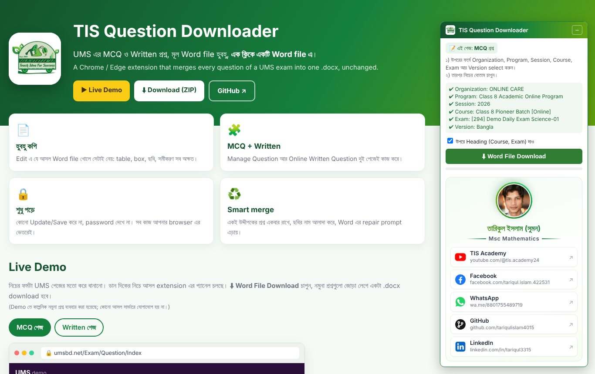
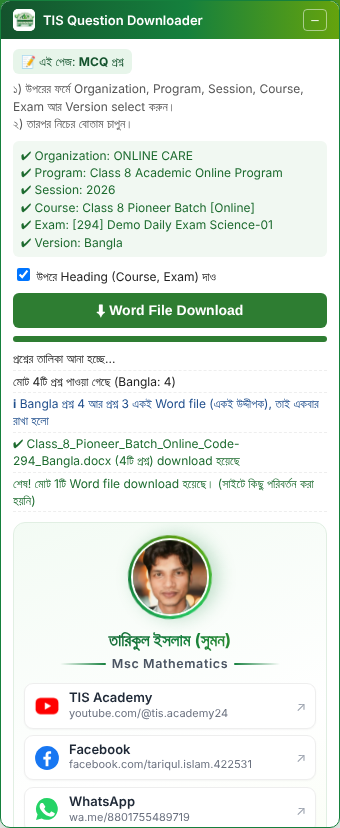
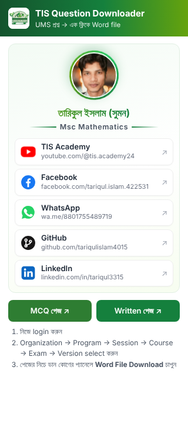

<div align="center">


# TIS Question Downloader

**UMS এর MCQ ও Written প্রশ্নের মূল Word file, হুবহু, এক ক্লিকে একটি Word file এ।**<br>
A Chrome / Edge extension that merges every question of a UMS exam into one `.docx`, unchanged.

[](https://tariqulislam4015.github.io/tis-question-downloader/)
[](https://github.com/tariqulislam4015/tis-question-downloader/archive/refs/heads/main.zip)




</div>

---

## ✨ Features

| | |
|---|---|
| 📄 **হুবহু কপি** | প্রতিটি প্রশ্নের Edit পেজে যে আসল Word file খোলে সেটাই নেয়। Table, box, ছবি, সমীকরণ (OMML) সব অক্ষত থাকে। |
| 🧩 **MCQ + Written** | `Exam/Question/Index` (MCQ) আর `Exam/OnlineWrittenQuestion/Index` (Written) দুই পেজেই কাজ করে। |
| 🔒 **শুধু পড়ে** | কোনো Update/Save করে না, password দেখে না। সব কাজ আপনার browser এর ভেতরেই হয়, বাইরে কিছু পাঠায় না। |
| ♻️ **Smart merge** | একই উদ্দীপকের প্রশ্ন একবার রাখে। ছবির নাম আলাদা করে। ভুল ক্রমে থাকা XML ঠিক করে, যাতে Word এ "repair" prompt না আসে। |
| 🌐 **Version / Set** | Version(ALL) দিলে Bangla ও English আলাদা file হয়। একাধিক Unique Set থাকলে প্রতিটি Set এর আলাদা file হয়। |
| 👤 **Profile card** | Developer এর ছবি, নাম আর সব link animated card এ দেখায় (প্যানেল ও toolbar popup এ)। |

## ▶ Live Demo

**<https://tariqulislam4015.github.io/tis-question-downloader/>**

Demo পেজে UMS এর মতো একটা নকল ফর্ম আছে, আর তার পাশে **আসল extension code** চলে।
**⬇ Word File Download** চাপলে কাল্পনিক নমুনা প্রশ্নগুলো জোড়া লেগে একটা `.docx` download হয়।
কোনো আসল সার্ভারে যোগাযোগ হয় না। ([`demo/demo.js`](demo/demo.js) browser এর ভেতরেই সার্ভারের উত্তর তৈরি করে।)

## 🚀 Install (Windows 10/11 · Chrome / Edge)

1. **[Download ZIP](https://github.com/tariqulislam4015/tis-question-downloader/archive/refs/heads/main.zip)** নামিয়ে Extract করুন। ভেতরের `extension` folder টা স্থায়ী জায়গায় রাখুন।
2. Chrome এ `chrome://extensions` (Edge এ `edge://extensions`) খুলুন।
3. **Developer mode** চালু করুন।
4. **Load unpacked** চেপে `extension` folder টা select করুন (যেখানে `manifest.json` আছে)।
5. Toolbar এ 🧩 চেপে **TIS Question Downloader** পিন 📌 করুন।

বিস্তারিত বাংলা নির্দেশিকা: [`extension/README-বাংলা.txt`](extension/README-বাংলা.txt)

## 🧭 Usage

1. UMS এ নিজে login করুন।
2. MCQ বা Written পেজে যান। নিচে ডান কোণে প্যানেল আসবে।
3. **Organization → Program → Session → Course → Exam → Version** select করুন। প্যানেলে প্রতিটির পাশে ✔ দেখাবে।
4. **⬇ Word File Download** চাপুন। File আপনার Downloads folder এ চলে যাবে, যেমন:
   - `Class_8_Pioneer_Batch_Online_Code-294_Bangla.docx`
   - `Class_8_Pioneer_Batch_Online_Written_Code-399_Bangla.docx`

<p align="center">
  
  &nbsp;&nbsp;
  
</p>

## ⚙️ How it works

```
UMS list endpoint ──► question rows ──► each row's "Edit" page ──► ONLYOFFICE config ──► original .docx
                                                                                         │
                                         merger.js (JSZip) ◄─────────────────────────────┘
                                                │  • body of each file, in order
                                                │  • images/charts copied with unique names
                                                │  • duplicate (shared-stem) files kept once
                                                │  • schema order fixed (tblPr, trPr, m:rPr)
                                                ▼
                                       one .docx → browser download
```

It only sends `GET` requests and the same read-only list `POST` the page itself makes. It never calls the editor's save/update endpoint.

## 📁 Project structure

```
extension/            the Chrome/Edge extension (load this folder)
  manifest.json       MV3 manifest
  content.js          panel UI + reading the question list + downloading originals
  merger.js           .docx merger (browser + Node)
  profile.js/.css     animated developer profile card
  popup.html/.js/.css toolbar popup
  jszip.min.js        JSZip 3.10.1 (MIT)
index.html            Live Demo / landing page (GitHub Pages)
demo/                 demo styles, fake-server script, fictional sample .docx files
tests/                node tests for merger.js
docs/screenshots/     README images
```

## 🧪 Tests

```bash
node tests/merge.test.js
```
No `npm install` needed. The tests check text order, header lines, de-duplication, image relationships, equations and the XML-order fixes.

## 👤 Developer


**তারিকুল ইসলাম (সুমন)**<br>
______Msc Mathematics______

[](https://www.youtube.com/@tis.academy24)
[](https://www.facebook.com/tariqul.islam.422531/)
[](https://wa.me/8801755489719)
[](https://github.com/tariqulislam4015)
[](https://www.linkedin.com/in/tariqul3315/)

<br clear="left">

## 📜 License

[MIT](LICENSE) © 2026 Tariqul Islam (Sumon). Bundled [JSZip](https://stuk.github.io/jszip/) is used under its MIT license ([`extension/JSZIP-LICENSE.markdown`](extension/JSZIP-LICENSE.markdown)).

> This is an independent helper tool for staff who already have access to UMS. It is not affiliated with or endorsed by UMS/Udvash/Online Care. Use it only on accounts and content you are authorised to access.
